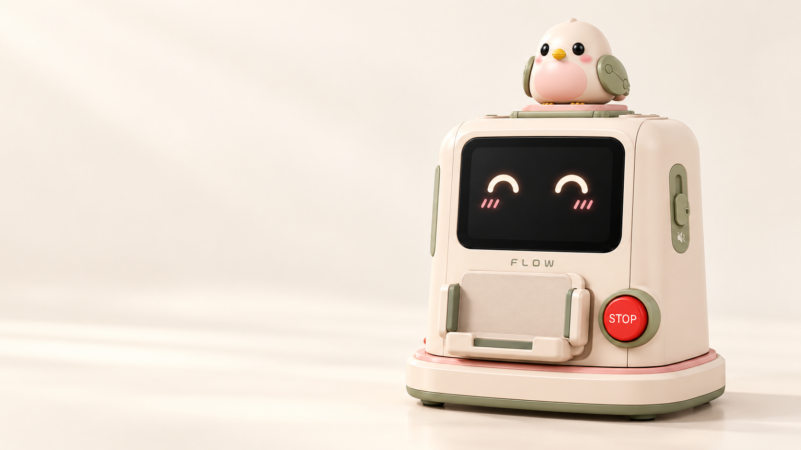

# 心流 Flow

**单通道情绪友好任务管家**

把「一堆做不完的事」，变成「下一步做什么」

A single-channel, emotion-friendly task companion

## 为什么需要 Flow

任务积压 → 失控感与焦虑 → 回避与拖延 → 积压更严重 → 焦虑加深。

这条循环里，真正让人喘不过气的往往不是任务本身，而是「什么都要做，却不知道从哪开始」的失控感。市面上的效率 App 大多只给出一个宏大的目标，却没有给出从 0 到 1 的入手点。

**Flow 的切入点，是切断「积压 → 焦虑」这一环**：把模糊的一堆待办，变成清晰、可执行、有人陪着的单通道流程，让用户始终只面对「下一步做什么」，从源头降低认知负荷和失控感。

效率工具最终是为了解决用户的情绪问题，而不是制造更多待办。

> **一个心理学线索**：奥夫相基娜效应（Ovsiankina effect）——任务被中断时，人天然想回去把它做完。当任务没法立刻解决时，这份冲动最好的出口，是一份详细、可执行的规划。

## 核心理念：单通道

多任务切换是注意力耗竭和「什么都做不完」挫败感的主要来源。单通道不是「只做一件事」，而是「只显示一件事」。

- **一次只有一个焦点**：屏幕上永远只呈现当前这一件事。
- **工具由对话直达**：时钟、任务清单、计划表、专注计时器、提醒与可选音乐，都能用一句话唤起，设备直接把工具递到面前。
- **不为用户增加决定**：任何新能力，只要让用户多做一次选择，默认不打开。

## 它如何工作

| 步骤 | 发生什么 | 屏幕上 |
| --- | --- | --- |
| **① 捕获** | 语音说、文字打，或拍下课程任务自动识别导入待办 | 一份确认过的待办 |
| **② 拆解** | 把杂乱任务算成计划：大任务拆小，落到「现在就能动手」的一步 | 计划草案 |
| **③ 确认** | 与用户商讨、修改，定下最终版 | 最终计划表 |
| **④ 执行** | 执行时只显示当前一步，到点提醒，计划可随进度重排 | 极简单步指引 |
| **⑤ 完成** | 每一步完成都有即时反馈与庆祝 | 表情 + 一句鼓励 |

从「说不清」到「现在就能做」，中间不需要用户自己完成规划。

## 核心功能

### 01 · 单通道工具管家

内置时钟、任务清单、计划表、专注计时器、提醒与可选音乐，统一由单通道调度。用户说一句「我要专注 25 分钟」，设备直接把计时器给出来，而不是让用户在层层菜单里找。

### 02 · 任务捕获与 AI 拆解

- 语音 / 文字输入杂乱的任务
- 摄像头拍照识别课程任务，自动导入待办，并与用户确认
- AI 把大任务拆成可立刻执行的小步骤
- 与用户商讨后确定最终计划

### 03 · 执行、提醒与自适应重排

执行态屏幕只显示当前这一步；定时提醒；计划可以随实际进度调整；检测到连续高强度任务后，主动建议休息。

### 04 · 手机与注意力管理

手机放在支架上即被感知，可充电。使用手机前先约定时长，到时间提醒归位。鼓励用户坦白分心的时刻，按个人习惯设置合理的娱乐时间——目标不是把学习时间越拉越长，而是**减少分心的次数**。

### 05 · 情绪反馈与激励

每个任务完成的瞬间都有正反馈与庆祝，对抗「做了也没用」的无力感；用养成游戏式的陪伴让坚持有温度。**不惩罚断更**：不扣分、不降级、不出现「你落后了」。

## 产品形态

- **桌面尺寸，便携**：可放在书桌一角
- **自带屏幕**：显示表情与文字信息
- **手机支架**：放手机 + 在位感应 + 充电 + 文件拍照传输
- **语音 + 手势**：代替触屏完成全部操作
- **小鸟伙伴**：可拆卸，用翅膀动作、歌声和简短回应陪伴，专注时保持安静
- **物理 STOP 与麦克风静音**：随时可以停下来

## 和常见效率 App 有什么不同

|  | 常见效率 App | 心流 Flow |
| --- | --- | --- |
| 切入点 | 给你一个目标，自己想办法开始 | 把目标拆成此刻能做的一步 |
| 注意力 | 多个列表、多个页面同时在场 | 单通道，屏幕上只有一个焦点 |
| 情绪 | 用打卡与连续天数施压 | 用即时反馈与陪伴降低焦虑 |
| 载体 | 手机里的又一个 App | 桌面上的实体伙伴，手机被放进支架而不是拿在手里 |

## 技术形态（规划中）

树莓派 + 嵌入式 Linux + 外接屏幕，本地优先，云端能力全部可降级。

| 层 | 方案 |
| --- | --- |
| 硬件 | 树莓派、小尺寸屏幕、麦克风 / 扬声器 / 摄像头、手机支架（在位与充电检测） |
| 交互 | 语音（唤醒 / 识别 / 合成）、手势、屏幕表情与文字 |
| 服务 | 本地服务持有单通道状态、计划与计时；屏幕只做渲染，通过 WebSocket 同步 |
| 数据 | 本地数据库，离线可用；LLM / 语音 / 视觉等云能力均有本地降级路径 |

> 现场断网是常态，所以每个依赖云的功能，都必须有本地能跑的版本。

## 项目状态

仓库正在按任务切片逐块实现。当前已落地：

- [x] 产品定义与交互原型
- [x] **T02** 硬件抽象层 HAL、mock 设备与开机自检
- [x] **T12** 拆解与规划规则引擎降级（LLM 主路径待接）
- [ ] **演示版**：说话 → 拆解 → 确认 → 单步执行
- [ ] **完整 MVP**：提醒、完成反馈、手机使用契约、多用户
- [ ] **完整体验**：养成游戏、分心画像、周报、手机文件通道

实现范围、运行命令与验收对照见 [DEVELOPMENT.md](DEVELOPMENT.md)。

## 关于

心流 Flow 是宁波诺丁汉大学 Ingenuity Lab 的产品项目。欢迎通过 Issue 交流想法，或提出希望看到的功能。

Made with care by the Flow team

