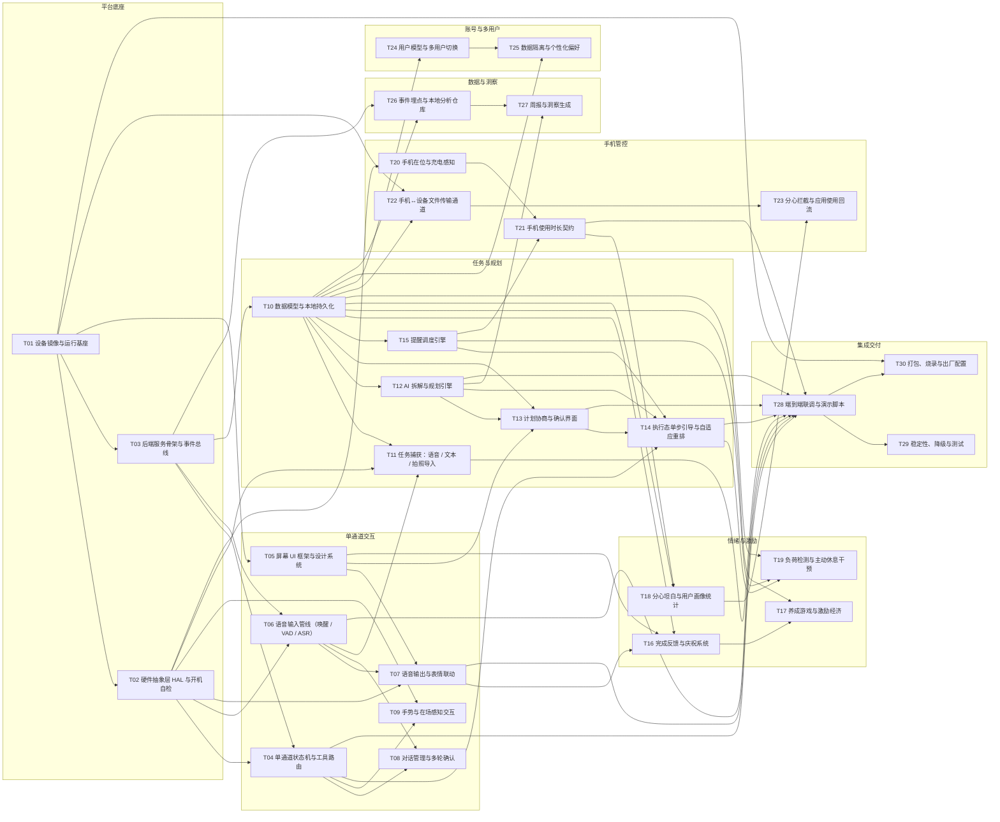
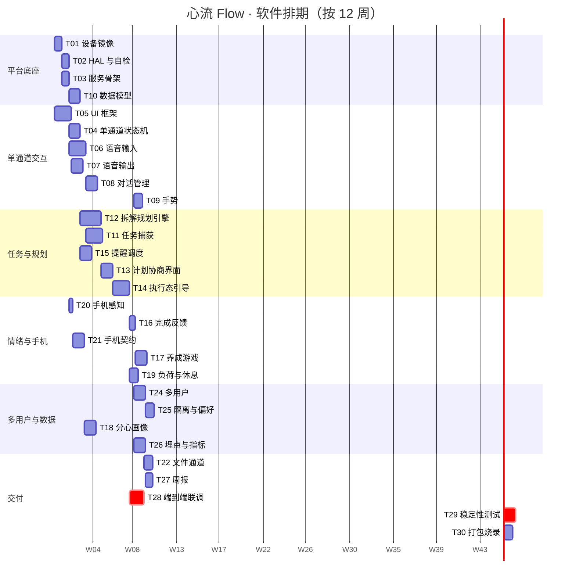

# 03 · 任务切片与排期

## 任务总表（30 个 / 约 66.0 人日）

| ID | 任务 | 工作流 | P | 规模 | 人日 | 前置依赖 | 需协同 | 建议角色 |
|---|---|---|---|---|---|---|---|---|
| [`T01`](tasks/P0-必做/T01-设备镜像与运行基座.md) | 设备镜像与运行基座 | PLT | P0 | M | 2.0 | — | T02、T03 | 嵌入式 / 运维 |
| [`T02`](tasks/P0-必做/T02-硬件抽象层 HAL 与开机自检.md) | 硬件抽象层 HAL 与开机自检 | PLT | P0 | M | 2.0 | T01 | T04、T09、T20 | 嵌入式 |
| [`T03`](tasks/P0-必做/T03-后端服务骨架与事件总线.md) | 后端服务骨架与事件总线 | PLT | P0 | M | 2.0 | T01 | T02、T05、T10 | 后端 |
| [`T04`](tasks/P0-必做/T04-单通道状态机与工具路由.md) | 单通道状态机与工具路由 | CHN | P0 | M | 2.0 | T02、T03 | T05、T06、T08、T14、T15 | 后端 |
| [`T05`](tasks/P0-必做/T05-屏幕 UI 框架与设计系统.md) | 屏幕 UI 框架与设计系统 | CHN | P0 | L | 4.0 | T01 | T03、T04、T13、T16 | 前端 |
| [`T06`](tasks/P0-必做/T06-语音输入管线（唤醒·VAD·ASR）.md) | 语音输入管线（唤醒 / VAD / ASR） | CHN | P0 | L | 3.5 | T02、T03 | T04、T07、T08、T11 | 语音 / AI |
| [`T07`](tasks/P0-必做/T07-语音输出与表情联动.md) | 语音输出与表情联动 | CHN | P0 | M | 2.0 | T02、T05、T06 | T03、T16、T19 | 语音 / 前端 |
| [`T08`](tasks/P0-必做/T08-对话管理与多轮确认.md) | 对话管理与多轮确认 | CHN | P0 | M | 2.0 | T04、T06 | T11、T12、T13 | AI / 后端 |
| [`T09`](tasks/P1-应做/T09-手势与在场感知交互.md) | 手势与在场感知交互 | CHN | P1 | M | 1.5 | T02、T04 | T05、T20 | 嵌入式 |
| [`T10`](tasks/P0-必做/T10-数据模型与本地持久化.md) | 数据模型与本地持久化 | TASK | P0 | M | 2.0 | T03 | T11、T12、T15、T24 | 后端 |
| [`T11`](tasks/P0-必做/T11-任务捕获：语音·文本·拍照导入.md) | 任务捕获：语音 / 文本 / 拍照导入 | TASK | P0 | L | 3.5 | T02、T06、T10 | T08、T12、T13、T22 | AI / 后端 |
| [`T12`](tasks/P0-必做/T12-AI 拆解与规划引擎.md) | AI 拆解与规划引擎 | TASK | P0 | L | 4.0 | T10 | T11、T13、T14、T27 | AI / 后端 |
| [`T13`](tasks/P0-必做/T13-计划协商与确认界面.md) | 计划协商与确认界面 | TASK | P0 | M | 2.0 | T05、T10、T12 | T04、T08、T14 | 前端 / 交互 |
| [`T14`](tasks/P0-必做/T14-执行态单步引导与自适应重排.md) | 执行态单步引导与自适应重排 | TASK | P0 | L | 3.5 | T04、T12、T13、T15 | T16、T17、T19 | 后端 / 前端 |
| [`T15`](tasks/P0-必做/T15-提醒调度引擎.md) | 提醒调度引擎 | TASK | P0 | M | 2.0 | T10 | T07、T14、T19、T21 | 后端 |
| [`T16`](tasks/P1-应做/T16-完成反馈与庆祝系统.md) | 完成反馈与庆祝系统 | EMO | P1 | S | 1.0 | T05、T07、T10 | T14、T17 | 前端 / 交互 |
| [`T17`](tasks/P1-应做/T17-养成游戏与激励经济.md) | 养成游戏与激励经济 | EMO | P1 | M | 2.0 | T10、T16 | T05、T18 | 前端 / 产品 |
| [`T18`](tasks/P1-应做/T18-分心坦白与用户画像统计.md) | 分心坦白与用户画像统计 | EMO | P1 | M | 2.0 | T10、T21 | T17、T23、T27 | 后端 / 产品 |
| [`T19`](tasks/P1-应做/T19-负荷检测与主动休息干预.md) | 负荷检测与主动休息干预 | EMO | P1 | M | 2.0 | T10、T14、T15 | T07、T17 | 后端 / 产品 |
| [`T20`](tasks/P0-必做/T20-手机在位与充电感知.md) | 手机在位与充电感知 | PHN | P0 | S | 0.5 | T02 | T21、T22 | 嵌入式 |
| [`T21`](tasks/P0-必做/T21-手机使用时长契约.md) | 手机使用时长契约 | PHN | P0 | M | 2.0 | T15、T20 | T07、T18、T23 | 后端 / 交互 |
| [`T22`](tasks/P1-应做/T22-手机↔设备文件传输通道.md) | 手机↔设备文件传输通道 | PHN | P1 | M | 2.0 | T01、T10 | T11、T21 | 后端 / 运维 |
| [`T23`](tasks/P2-可选/T23-分心拦截与应用使用回流.md) | 分心拦截与应用使用回流 | PHN | P2 | L | 3.0 | T18、T22 | T21 | 移动端 / 后端 |
| [`T24`](tasks/P1-应做/T24-用户模型与多用户切换.md) | 用户模型与多用户切换 | USR | P1 | M | 2.0 | T10 | T05、T25 | 后端 / 产品 |
| [`T25`](tasks/P1-应做/T25-数据隔离与个性化偏好.md) | 数据隔离与个性化偏好 | USR | P1 | M | 2.0 | T10、T24 | T07、T12、T26 | 后端 |
| [`T26`](tasks/P1-应做/T26-事件埋点与本地分析仓库.md) | 事件埋点与本地分析仓库 | DAT | P1 | M | 2.0 | T03、T10 | T18、T27 | 后端 / 数据 |
| [`T27`](tasks/P2-可选/T27-周报与洞察生成.md) | 周报与洞察生成 | DAT | P2 | M | 1.5 | T12、T26 | T05、T16、T18 | AI / 后端 |
| [`T28`](tasks/P0-必做/T28-端到端联调与演示脚本.md) | 端到端联调与演示脚本 | INT | P0 | M | 2.0 | T04、T06、T07、T11、T12、T13、T14、T21 | T29、T30 | 全员 / 集成 |
| [`T29`](tasks/P0-必做/T29-稳定性、降级与测试.md) | 稳定性、降级与测试 | INT | P0 | M | 2.0 | T28 | 全员 | 测试 / 全员 |
| [`T30`](tasks/P1-应做/T30-打包、烧录与出厂配置.md) | 打包、烧录与出厂配置 | INT | P1 | M | 2.0 | T01、T28 | T29 | 运维 / 集成 |

**优先级分布**：P0 18 个 / 43.0 人日，P1 10 个 / 18.5 人日，P2 2 个 / 4.5 人日。

## 按工作流分组

### `PLT` 平台底座 — 让设备能开机即用，让上层不用碰硬件（3 个 / 6.0 人日）

- [T01 设备镜像与运行基座](tasks/P0-必做/T01-设备镜像与运行基座.md) — P0（2 人日）
- [T02 硬件抽象层 HAL 与开机自检](tasks/P0-必做/T02-硬件抽象层 HAL 与开机自检.md) — P0（2 人日）
- [T03 后端服务骨架与事件总线](tasks/P0-必做/T03-后端服务骨架与事件总线.md) — P0（2 人日）

### `CHN` 单通道交互 — 产品的核心机制：一次只给一件事 + 语音/手势代替触屏（6 个 / 15.0 人日）

- [T04 单通道状态机与工具路由](tasks/P0-必做/T04-单通道状态机与工具路由.md) — P0（2 人日）
- [T05 屏幕 UI 框架与设计系统](tasks/P0-必做/T05-屏幕 UI 框架与设计系统.md) — P0（4 人日）
- [T06 语音输入管线（唤醒 / VAD / ASR）](tasks/P0-必做/T06-语音输入管线（唤醒·VAD·ASR）.md) — P0（3.5 人日）
- [T07 语音输出与表情联动](tasks/P0-必做/T07-语音输出与表情联动.md) — P0（2 人日）
- [T08 对话管理与多轮确认](tasks/P0-必做/T08-对话管理与多轮确认.md) — P0（2 人日）
- [T09 手势与在场感知交互](tasks/P1-应做/T09-手势与在场感知交互.md) — P1（1.5 人日）

### `TASK` 任务与规划 — 从一堆模糊的事到一条能立刻动手的下一步（6 个 / 17.0 人日）

- [T10 数据模型与本地持久化](tasks/P0-必做/T10-数据模型与本地持久化.md) — P0（2 人日）
- [T11 任务捕获：语音 / 文本 / 拍照导入](tasks/P0-必做/T11-任务捕获：语音·文本·拍照导入.md) — P0（3.5 人日）
- [T12 AI 拆解与规划引擎](tasks/P0-必做/T12-AI 拆解与规划引擎.md) — P0（4 人日）
- [T13 计划协商与确认界面](tasks/P0-必做/T13-计划协商与确认界面.md) — P0（2 人日）
- [T14 执行态单步引导与自适应重排](tasks/P0-必做/T14-执行态单步引导与自适应重排.md) — P0（3.5 人日）
- [T15 提醒调度引擎](tasks/P0-必做/T15-提醒调度引擎.md) — P0（2 人日）

### `EMO` 情绪与激励 — 把效率工具变成情绪工具：反馈、陪伴、休息、坦白（4 个 / 7.0 人日）

- [T16 完成反馈与庆祝系统](tasks/P1-应做/T16-完成反馈与庆祝系统.md) — P1（1 人日）
- [T17 养成游戏与激励经济](tasks/P1-应做/T17-养成游戏与激励经济.md) — P1（2 人日）
- [T18 分心坦白与用户画像统计](tasks/P1-应做/T18-分心坦白与用户画像统计.md) — P1（2 人日）
- [T19 负荷检测与主动休息干预](tasks/P1-应做/T19-负荷检测与主动休息干预.md) — P1（2 人日）

### `PHN` 手机管控 — 管住注意力外流：在位感知、使用契约、文件通道（4 个 / 7.5 人日）

- [T20 手机在位与充电感知](tasks/P0-必做/T20-手机在位与充电感知.md) — P0（0.5 人日）
- [T21 手机使用时长契约](tasks/P0-必做/T21-手机使用时长契约.md) — P0（2 人日）
- [T22 手机↔设备文件传输通道](tasks/P1-应做/T22-手机↔设备文件传输通道.md) — P1（2 人日）
- [T23 分心拦截与应用使用回流](tasks/P2-可选/T23-分心拦截与应用使用回流.md) — P2（3 人日）

### `USR` 账号与多用户 — 一台设备服务多个人，数据不串、偏好不混（2 个 / 4.0 人日）

- [T24 用户模型与多用户切换](tasks/P1-应做/T24-用户模型与多用户切换.md) — P1（2 人日）
- [T25 数据隔离与个性化偏好](tasks/P1-应做/T25-数据隔离与个性化偏好.md) — P1（2 人日）

### `DAT` 数据与洞察 — 用数据证明“它真的帮到了我”（2 个 / 3.5 人日）

- [T26 事件埋点与本地分析仓库](tasks/P1-应做/T26-事件埋点与本地分析仓库.md) — P1（2 人日）
- [T27 周报与洞察生成](tasks/P2-可选/T27-周报与洞察生成.md) — P2（1.5 人日）

### `INT` 集成交付 — 把模块拧成一条不断掉的演示线，并能复制到第二台设备（3 个 / 6.0 人日）

- [T28 端到端联调与演示脚本](tasks/P0-必做/T28-端到端联调与演示脚本.md) — P0（2 人日）
- [T29 稳定性、降级与测试](tasks/P0-必做/T29-稳定性、降级与测试.md) — P0（2 人日）
- [T30 打包、烧录与出厂配置](tasks/P1-应做/T30-打包、烧录与出厂配置.md) — P1（2 人日）

## 依赖图

> 只画了硬依赖。读法是：箭头指出去的任务必须先完成，接收箭头的才能开工。没画箭头但仍需协同的，见各任务卡的“需协同”。

## 里程碑与排期（12 周）

| 里程碑 | 名称 | 时间 | 包含任务 | 出口标准 |
|---|---|---|---|---|
| **M1** | 骨架可跑 | 第 1–2 周 | T01、T02、T03、T10、T05 | 设备能开机进界面，后端有 WS，数据库能读写，UI 有设计系统和待机页。 |
| **M2** | 单通道 + 语音闭环 | 第 3–4 周 | T04、T06、T07、T08 | 说一句话能打开对应工具；机器人能用语音+表情回应；对话能追问与确认。 |
| **M3** | 主链路跑通 | 第 5–7 周 | T11、T12、T13、T14、T15 | 从“杂乱任务”到“执行单步”全链路可走；提醒能按时响；计划延误能重排。 |
| **M4** | 情绪层与手机契约 | 第 8–9 周 | T16、T17、T19、T20、T21 | 完成任务有庆祝与成长；连续工作会被建议休息；拿手机需要约定时长并提醒归位。 |
| **M5** | 多用户与数据洞察 | 第 10–11 周 | T18、T24、T25、T26、T09、T22 | 多用户隔离成立；分心画像与指标可查；手势与手机传文件可用。 |
| **M6** | 集成与交付 | 第 12 周 | T27、T28、T29、T30 | 三条彩排不掉线；故障注入可自恢复；能复制到第二台设备。 |

> Gantt 里的日期是相对示意（第 1 天起算），实际请按你学校的周次平移。关键是**顺序和并行度**，不是具体日期。

## 三条切片线（按时间选一条）

### 切片 A · 演示级 — 12 个任务 / 31.0 人日

能演完“说话 → 拆解 → 确认 → 执行单步”这条主线。适合课程中期检查或时间只有 6 周的情况。

任务：`T01`、`T02`、`T03`、`T04`、`T05`、`T06`、`T07`、`T10`、`T12`、`T13`、`T14`、`T28`

实际人日：**31.0**

### 切片 B · 完整 MVP — 22 个任务 / 49.5 人日

覆盖产品文档里所有 P0 功能且多用户可跑。适合作为期末交付目标。

任务：`T01`、`T02`、`T03`、`T04`、`T05`、`T06`、`T07`、`T08`、`T10`、`T11`、`T12`、`T13`、`T14`、`T15`、`T16`、`T20`、`T21`、`T24`、`T28`、`T29`、`T30`、`T09`

实际人日：**49.5**

### 切片 C · 完整体验 — 30 个任务 / 66.0 人日

再加养成、分心画像、周报、文件通道、手机应用数据回流（P2）。适合作为长期演进路线。

任务：`T01`、`T02`、`T03`、`T04`、`T05`、`T06`、`T07`、`T08`、`T09`、`T10`、`T11`、`T12`、`T13`、`T14`、`T15`、`T16`、`T17`、`T18`、`T19`、`T20`、`T21`、`T22`、`T23`、`T24`、`T25`、`T26`、`T27`、`T28`、`T29`、`T30`

实际人日：**66.0**

## 分工建议

### 4 人团队

| 角色 | 主责工作流 | 首批任务 | 说明 |
|---|---|---|---|
| A 后端 / 架构 | PLT + INT | T03 → T10 → T28 | 唯一改 schema 的人，接口裁判 |
| B AI / 算法 | TASK + DAT | T12 → T11 → T26 | 拆解引擎是核心，优先保障 |
| C 前端 / 交互 | CHN | T05 → T13 → T14 | 所有屏幕上的东西归他 |
| D 嵌入式 | PLT + PHN | T01 → T02 → T20 → T09 | 硬件联调 + 现场保障 |

语音（T06/T07）由 B 与 C 共担；情绪层（T16–T19）由 C 主导、A 配合。

### 6 人团队

在上面基础上加：

- **E 语音 / 算法**：独立负责 T06、T07、T08，把识别率和响应速度做扎实。
- **F 产品 / 测试**：负责 T16、T19、T27、T29，撰写演示脚本（T28 的一半），做破坏性测试。

### 2–3 人小组（时间紧张）

只做 **切片 A**，并且合并任务：T01+T02 一人做、T03+T10+T12 一人做、T05+T13+T14 一人做。砍掉 T09、T11、T22、T23，语音只做“按键说话”。

## 风险与对策

| 风险 | 影响 | 对策 |
|---|---|---|
| 硬件到货晚 | 全组停摆 | 第一天就把 T02 的 mock 写完，全组在电脑上开发 |
| LLM / 云服务额度用尽 | 演示翻车 | T12 的规则引擎降级必须做，否则不允许上 LLM |
| schema 反复改 | 联调返工 | 第 2 周冻结 P0 表结构，之后只加表不改字段 |
| 语音识别率不达标 | 交互不可用 | 提前一周在真实环境（教室/宿舍）测，不要只在工位测 |
| 演示前还在改代码 | 现场崩溃 | 演示前 3 天功能冻结，只修 bug |
| 单人承担过多 P0 | 进度崩盘 | 每周看一次任务卡的负责人，P0 任务不允许一个人同时持有 3 个以上 |
